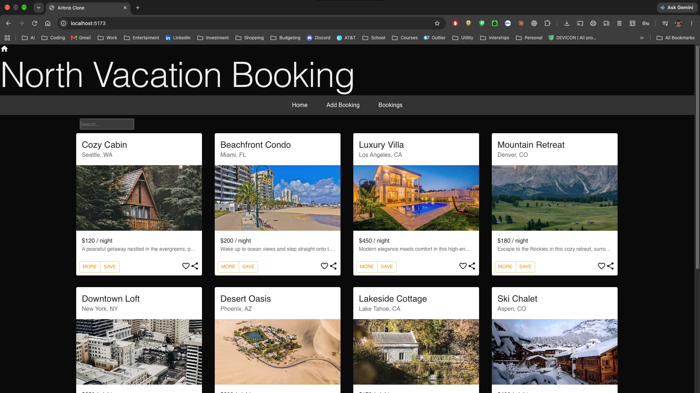
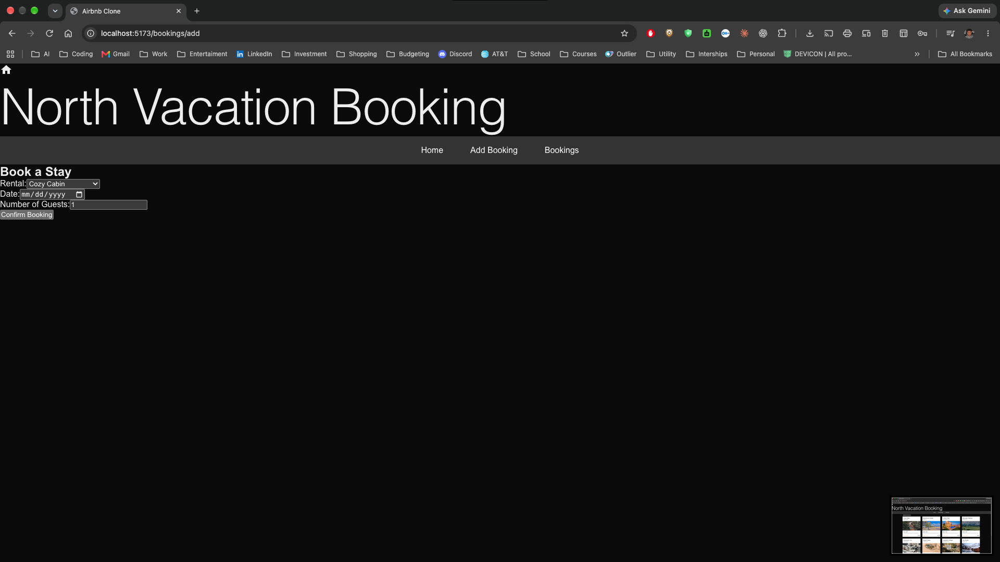
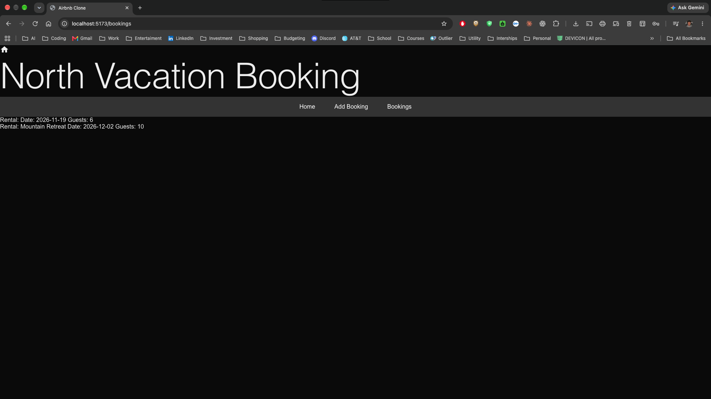

# Learning Practice: Experience-Based Testing

## Topics

- Error guessing
- Exploratory testing
- Checklist-based testing
- Acceptance testing

## Learning Objectives

By the end of this practice, you should be able to:

- Use your experience with similar websites to predict possible failures.
- Investigate a feature through a focused exploratory testing session.
- Create and perform a reusable testing checklist.
- Write acceptance criteria from an end user's perspective.
- Determine whether a feature satisfies its acceptance criteria.
- Record your testing clearly enough that another person can understand what you tested and what happened.

## Resources

- [What Is Acceptance Testing?](https://agilealliance.org/glossary/acceptance-testing/)
- [Applying BDD Acceptance Criteria in User Stories](https://www.thoughtworks.com/en-us/insights/blog/applying-bdd-acceptance-criteria-user-stories)

## Step 1: Error Guessing

Choose one feature of the `airbnb-clone-ts` application, such as creating or viewing a booking.

Based on your experience with similar websites, list **three things you think might go wrong**.

These are predictions based on your experience, knowledge, and instincts. You do not need to prove that they are defects at this point.

## Step 2: Exploratory Testing

Write a one-sentence **testing charter** describing what you want to investigate about your selected feature.

Spend **10 to 15 minutes** testing the feature. As you work, briefly record:

- What you tried
- What happened
- What you decided to investigate next

Your testing should remain focused on the goal described in your charter. If you discover a new area that you want to investigate, record it as an idea for a future testing session.

<details>
<summary>Exploratory testing notes</summary>

| What I Tried | What Happened | What I Decided to Try Next |
| ------------ | ------------- | -------------------------- |
|              |               |                            |
|              |               |                            |

</details>

## Step 3: Checklist-Based Testing

Create a checklist containing at least **five checks** for the same feature.

You may use ideas from:

- Your error guesses
- Your exploratory testing session
- Problems you have experienced with similar applications
- Common usability or validation concerns

Perform each check and record one of the following results:

- **Passed**
- **Failed**
- **Unable to Test**

Include a brief note when a result needs additional explanation.

<details>
<summary>Checklist format</summary>

| Check | Result | Notes |
| ----- | ------ | ----- |
|       |        |       |
|       |        |       |

</details>

## Step 4: Acceptance Testing

The previous steps approach the feature from a tester's perspective by predicting failures, exploring behavior, and completing specific checks.

Acceptance testing approaches the feature from the end user's perspective. It asks whether the feature allows the user to accomplish the goal it was created to support.

Acceptance criteria are often written using the **Given, When, Then** format:

- **Given:** The starting condition
- **When:** The action the user performs
- **Then:** The specific result that should occur

For example:

```text
Given I am on the booking form,
when I submit a rental, date, and number of guests,
then the reservation should appear in my list of bookings.
```

For the same feature you selected in Step 1:

- Write **three to five acceptance criteria** using the Given, When, Then format.
- Write each criterion from the user's perspective.
- Make each expected result specific enough to determine whether it passed or failed.
- Perform each criterion against the running application.
- Mark each result as **Passed**, **Failed**, or **Unable to Test**.
- If a criterion fails, explain what happened.

<details>
<summary>Acceptance criteria format</summary>

| Given, When, Then                | Result | Notes |
| -------------------------------- | ------ | ----- |
| Given **_, when _**, then \_\_\_ |        |       |
| Given **_, when _**, then \_\_\_ |        |       |

</details>

A checklist item usually describes one specific check, such as submitting a form with an empty date. An acceptance criterion describes whether the user can accomplish a complete goal, such as successfully booking a rental.

Your checklist and acceptance criteria may overlap because they examine the same feature for different purposes.

## What to Submit

1. Create and initialize a GitHub repository.
2. Commit and push your work to the repository.
3. Make sure the repository is public. Private repositories will not receive credit.
4. Submit the URL on Canvas.

## AI Transparency

AI was used to help create portions of this file and to clean up its writing and formatting.

---

# My Completed Work: Experience-Based Testing

**Application:** North Vacation Booking (`airbnb-clone-ts`)
**Feature tested:** Creating a booking (the **Add Booking** page at `/bookings/add`, and the **Bookings** page at `/bookings` where the new booking should show up)
**Test date:** November 9, 2026
**Environment:** Linux, Node.js v22.23.4, npm 10.9.9, Chromium (driven through Playwright), json-server 0.17.4, Vite 5.4.21

I used the booking creation feature for every step below.

## How to Set Up and Run the Application

The app has two parts that need to run at the same time:

1. A fake REST API (`json-server`) that serves the rentals from `db.json` on port **3001**
2. The React app (Vite dev server) on port **5173**

```bash
cd airbnb-clone-ts
npm install
```

**Terminal 1 – start the API:**

```bash
npx json-server --watch db.json --port 3001
```

**Terminal 2 – start the app:**

```bash
npm run dev
```

Then open <http://localhost:5173>.

**Important:** Open the **Home** page first and then click **Add Booking**. The rentals list is only loaded when the Home page is visited (see the findings below).

To make a production build:

```bash
npm run build
npm run preview
```

I ran `npm install` and `npm run build` on the original starter code and the build finished with no errors. I did **not** change any of the application code.

---

## Step 1: Error Guessing

Based on my experience with booking and travel websites, here are three things I predicted might go wrong when creating a booking:

| # | Prediction | Why I think this might happen |
| - | ---------- | ----------------------------- |
| 1 | **The rental that shows in the dropdown might not be the one that gets saved.** | A lot of forms show the first option in a dropdown but don't actually "select" it until the user changes it. If the code starts with an empty value, the booking could be saved with no rental. |
| 2 | **The form might accept bad dates or guest counts.** | Many simple sites only check that a field isn't empty. I expect it might allow dates in the past, an empty guest count, or a huge number of guests. |
| 3 | **There might be no confirmation, and bookings might not be saved for real.** | Small apps often just add the booking to memory. I expect that there might be no "booking confirmed" message, that clicking twice makes duplicates, and that refreshing the page could lose the booking. |

---

## Step 2: Exploratory Testing

### Testing Charter

> Explore the Add Booking form with valid, missing, and unusual rental, date, and guest values to find out whether bookings are saved correctly and whether the user gets clear feedback.

### Exploratory Testing Notes

These are the real results from my session against the running app.

| What I Tried | What Happened | What I Decided to Try Next |
| ------------ | ------------- | -------------------------- |
| Opened Home, then clicked **Add Booking** and looked at the form | The dropdown listed all 10 rentals with **Cozy Cabin** showing first. The date was empty and guests was set to 1. | Make one normal booking to see what success looks like. |
| Picked **Luxury Villa**, date 2026-12-20, 3 guests, clicked **Confirm Booking** | Nothing visible happened. There was no message, the form did not clear, and I stayed on the same page. When I opened **Bookings** it showed `Rental: Luxury Villa Date: 2026-12-20 Guests: 3`. | Test my first error guess and leave the dropdown alone. |
| Left the dropdown showing **Cozy Cabin** (did not touch it), entered a date, and submitted | The Bookings page showed `Rental:  Date: 2026-12-20 Guests: 1`. **The rental name was blank** even though the form showed Cozy Cabin. | Try submitting with fields missing. |
| Picked a rental and left the date empty, then submitted | The browser blocked it with "Please fill out this field." No booking was added. | Try strange guest numbers. |
| Set guests to 0, -2, and 2.5 | All three were blocked by the browser. 0 and -2 said "Value must be greater than or equal to 1." 2.5 said "Please enter a valid value. The two nearest valid values are 2 and 3." | Try an empty guest box and a very big number. |
| Cleared the guests box (empty) and submitted | It was accepted. The booking showed `Guests: ` with nothing after it. | Try a very large number. |
| Entered 999 guests | Accepted with no warning: `Guests: 999`. | Try a date in the past. |
| Picked the date 2020-01-01 | Accepted. The booking showed `Date: 2020-01-01`. | Try a date that doesn't exist. |
| Typed 02/30/2026 into the date field | The browser did not accept it. The field stayed empty and submitting showed "Please enter a valid value. The field is incomplete or has an invalid date." | Test double-clicking the button. |
| Clicked **Confirm Booking** twice quickly | Two identical bookings were created (Downtown Loft, 2026-12-24, 2 guests). | See what happens if I go straight to the form URL. |
| Opened `/bookings/add` directly without visiting Home first | The rental dropdown was **completely empty** (0 options). I could still enter a date and submit, and it made a booking with a blank rental. | Check whether bookings survive a page refresh. |
| Made a booking and then refreshed the Bookings page | The booking disappeared. The Bookings page was blank. | Look at the empty Bookings page. |
| Opened Bookings with no bookings made | The page was completely blank, with no "You have no bookings" message. | End of session. Write down ideas for later. |

> **Note about the session:** The table above was first run in Chromium with an automated browser script (with help from an AI assistant, see the AI Transparency section). The scripts are saved in [`test-evidence/`](test-evidence/). I then tested the app by hand in Google Chrome, as shown below.

### Hands-On Manual Session (Google Chrome)

I ran the app on my own computer (`localhost:5173`) and tested booking creation by hand.

| What I Tried | What Happened | What I Decided to Try Next |
| ------------ | ------------- | -------------------------- |
| Opened the Home page | All rentals loaded as cards with a name, location, photo, price per night, and More/Save buttons. | Go to the booking form. |
| Clicked **Add Booking** | The "Book a Stay" form showed **Cozy Cabin** in the dropdown, an empty date (`mm/dd/yyyy`), and 1 guest. | Book without changing the dropdown. |
| Left the dropdown on Cozy Cabin, picked 11/19/2026, entered 6 guests, and clicked **Confirm Booking** | On the Bookings page it showed `Rental: Date: 2026-11-19 Guests: 6`. **The rental name was missing**, the same bug the scripted test found. | Pick a rental on purpose to compare. |
| Picked **Mountain Retreat**, 12/02/2026, 10 guests, and confirmed | The Bookings page showed `Rental: Mountain Retreat Date: 2026-12-02 Guests: 10`. This booking was saved correctly. 10 guests was accepted with no limit. | Compare the two bookings on the Bookings page. |
| Looked at the Bookings page | Both bookings appear as plain lines of text. There is no price, location, booking number, or way to edit or cancel. | Save ideas for a future session. |

**Screenshots from my manual session:**

| Home page | Add Booking form | Bookings list |
| --------- | ---------------- | ------------- |
|  |  |  |

The manual session confirmed the biggest bug: if the user keeps the default rental (Cozy Cabin), the booking is saved **without a rental name**. It only saves correctly when the user picks a rental from the dropdown.

### Ideas for Future Testing Sessions

These are outside my charter, so I am saving them for later:

- Test the **Home page search box** (does it filter the rentals correctly, does it handle upper/lowercase?).
- Test what happens when **json-server is not running** (does the Home page show an error or just stay blank?).
- Test the booking form on a **phone-sized screen** and with **keyboard only** (tabbing through fields).
- Test the **More** and **Save** buttons on the rental cards (they did not seem to do anything).
- Test in **other browsers** (Firefox, Safari), since date and number checks come from the browser itself.
- Test whether the form should have a **check-out date**, a **price total**, and a **max guests per rental**.
- Test whether the Bookings page should show more details (price, location) and let users **edit or cancel** a booking.

---

## Step 3: Checklist-Based Testing

Every check was run against the running app, in a fresh browser page each time (Home → Add Booking) unless the notes say something different.

| # | Check | Result | Notes |
| - | ----- | ------ | ----- |
| 1 | **Valid input:** Picking a rental, a future date, and 3 guests creates a booking on the Bookings page | **Passed** | Showed `Rental: Luxury Villa Date: 2026-12-20 Guests: 3`. |
| 2 | **Default rental:** The rental shown in the dropdown (Cozy Cabin) is the one saved if I don't change it | **Failed** | Saved with a blank rental: `Rental:  Date: 2026-12-20 Guests: 1`. |
| 3 | **Missing field – date:** Submitting with no date is blocked | **Passed** | Browser message: "Please fill out this field." No booking was added. |
| 4 | **Missing field – guests:** Submitting with the guests box empty is blocked | **Failed** | Accepted. The booking showed `Guests: ` with no number. |
| 5 | **Missing field – rental:** The form can't be submitted without a rental | **Failed** | When I opened `/bookings/add` directly, the dropdown was empty and the booking was still saved with a blank rental. |
| 6 | **Invalid date:** A date that doesn't exist (02/30/2026) is rejected | **Passed** | The browser blocked it: "The field is incomplete or has an invalid date." |
| 7 | **Invalid date:** A date in the past (2020-01-01) is rejected | **Failed** | Accepted and saved as `Date: 2020-01-01`. |
| 8 | **Guest count:** 0 guests is rejected | **Passed** | "Value must be greater than or equal to 1." |
| 9 | **Guest count:** A negative number (-2) is rejected | **Passed** | Same message as above. |
| 10 | **Guest count:** A decimal (2.5) is rejected | **Passed** | "Please enter a valid value. The two nearest valid values are 2 and 3." |
| 11 | **Guest count:** The number of guests can't be more than the rental allows | **Unable to Test** | The rentals in `db.json` don't have a max guest number, so there is no limit to check against. I did see that 999 guests was accepted. |
| 12 | **Booking confirmation:** A success message appears after clicking Confirm Booking | **Failed** | No message. The form stays filled in and the page doesn't change. The only way to know it worked is to open Bookings yourself. |
| 13 | **Duplicates:** Clicking Confirm Booking twice does not make two bookings | **Failed** | Two identical bookings were created. |
| 14 | **Saved bookings:** A booking is still there after refreshing the page | **Failed** | The Bookings page was blank after refreshing. |
| 15 | **Date range:** The check-out date must be after the check-in date | **Unable to Test** | The form only has one date field, so there is no check-out date to test. |

**Summary:** 6 Passed, 7 Failed, 2 Unable to Test.

---

## Step 4: Acceptance Testing

These are written from the point of view of a traveler who wants to book a stay.

| # | Given, When, Then | Result | Notes |
| - | ----------------- | ------ | ----- |
| 1 | **Given** I opened the Home page and then the Add Booking page, **when** I choose "Luxury Villa", pick 12/20/2026, enter 3 guests, and click Confirm Booking, **then** my Bookings page should list Luxury Villa on 2026-12-20 for 3 guests. | **Passed** | Bookings showed `Rental: Luxury Villa Date: 2026-12-20 Guests: 3`. |
| 2 | **Given** I am on the Add Booking page and the dropdown shows "Cozy Cabin", **when** I keep Cozy Cabin, choose a date, and click Confirm Booking, **then** my Bookings page should list a booking for Cozy Cabin. | **Failed** | The booking was saved with no rental name (`Rental:  Date: 2026-12-20 Guests: 1`). The form shows Cozy Cabin, but the app's starting value is empty and only changes if I pick a different option. |
| 3 | **Given** I filled out the booking form correctly, **when** I click Confirm Booking, **then** I should see a message confirming my booking or be taken to my Bookings page. | **Failed** | Nothing happened on screen. There was no message, the form didn't clear, and I stayed on `/bookings/add`. As a user I couldn't tell if the booking worked. |
| 4 | **Given** I am on the Add Booking page, **when** I click Confirm Booking without picking a date, **then** no booking should be made and I should be told the date is needed. | **Passed** | The browser showed "Please fill out this field." and the Bookings page stayed empty. |
| 5 | **Given** I made a booking, **when** I refresh the page or come back to the Bookings page later, **then** my booking should still be listed. | **Failed** | After a refresh, the Bookings page was blank. Bookings are only kept in memory while the page is open and are not saved to `db.json`. |

**Summary:** 2 Passed, 3 Failed. Right now a user can only book successfully if they visit Home first and actively change the rental dropdown, and they won't get any confirmation.

---

## Comparing My Error Guesses to What Happened

| Prediction | What I Found |
| ---------- | ------------ |
| 1. The displayed rental might not be the one saved | **Confirmed.** Leaving the dropdown on Cozy Cabin saved a blank rental. |
| 2. Bad dates or guest counts might be accepted | **Partly confirmed.** Past dates, empty guests, and 999 guests were accepted. But 0, negative, decimal guests, and impossible dates were blocked by the browser. |
| 3. No confirmation, and bookings might not be saved | **Confirmed.** There was no confirmation message, double-clicking made duplicates, and a refresh erased all bookings. |

---

## Remaining Manual Testing

- [x] Do a hands-on exploratory session by myself in a browser (Step 2). Done in Google Chrome, see "Hands-On Manual Session" and the screenshots.
- [ ] Make sure my hands-on session lasted the full **10–15 minutes** and add any extra notes to the manual session table.
- [ ] Optionally repeat a few checks in a second browser (for example Firefox), because the date and number checks come from the browser.

---

## Repository Contents

| Path | What it is |
| ---- | ---------- |
| `README.md` | Original assignment instructions (unchanged, at the top) plus my completed work (this section) |
| `airbnb-clone-ts/` | The original North Vacation Booking starter app (code not changed) |
| `test-evidence/explore.js`, `test-evidence/followup.js` | The Playwright scripts used to run the exploratory, checklist, and acceptance tests in Chromium. They need the API on port 3001 and the app on port 5173 running, plus Playwright installed (`node test-evidence/explore.js`). |
| `screenshots/` | Screenshots from my hands-on session in Google Chrome (Home page, Add Booking form, Bookings list) |
| `.gitignore` | Keeps `node_modules`, `dist`, and other generated files out of Git |

## AI Transparency Statement (My Work)

I used an AI assistant (Claude) to help with this assignment. It helped set up and run the app, write and run the automated browser scripts used for testing, and draft and format the documentation in this README. All of the results in the tables come from actually running the app; nothing was made up. Tests that could not be done are marked **Unable to Test**. I reviewed the results, and I also tested the app by hand in Google Chrome (see the screenshots).
